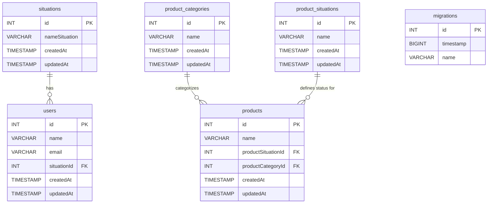

# NODEAPI - Classroom Project

API RESTful desenvolvida com **Node.js**, **Express**, **TypeScript**, **TypeORM** e **PostgreSQL** (ou MySQL), estruturada para gestão de utilizadores, autenticação e catálogo de produtos.

---

## 🛠️ Tecnologias Utilizadas

- **Runtime:** Node.js (v18+)
- **Linguagem:** TypeScript
- **Framework Web:** Express
- **ORM:** TypeORM
- **Banco de Dados:** PostgreSQL / MySQL (`pg` / `mysql2`)
- **Utilitários:** `dotenv`, `reflect-metadata`, `ts-node-dev`, `concurrently`

---


## ⚙️ Variáveis de Ambiente (`.env`)

Crie um ficheiro `.env` na raiz do projeto com as seguintes variáveis:

```env
DB_DIALECT="postgres"      # ou "mysql"
DB_HOST="localhost"
DB_PORT=
DB_DATABASE="nodeapi"
DB_USERNAME="postgres"
DB_PASSWORD="sua_senha_aqui"

PORT=8080

```

---

## 🚀 Como Executar o Projeto

1. **Instalar dependências:**
```bash
npm install

```


2. **Executar em modo de desenvolvimento:**
```bash
npm run dev

```


3. **Compilar e rodar em produção:**
```bash
npm run build
npm run start

```


4. **Compilação contínua (Watch mode):**
```bash
npm run start:watch

```


---

## 🗄️ Migrations (TypeORM)

### Criar uma nova migration:

```bash
npx typeorm migration:create src/migration/NomeDaMigration

```

### Executar migrations pendentes:

```bash
npx typeorm migration:run -d dist/data-source.js

```

### Reverter a última migration:

```bash
npx typeorm migration:revert -d dist/data-source.js

```

---

## 📊 Diagrama de Entidade-Relacionamento (DER)



---

## 📝 Detalhamento das Entidades

### 1. `users` (Utilizadores)

Representa as contas de utilizadores registadas no sistema.

* `id` (INT, PK): Identificador único do utilizador.
* `name` (VARCHAR): Nome completo.
* `email` (VARCHAR): Endereço de e-mail (usado para login).
* `situationId` (INT, FK): Referência à situação atual do utilizador na tabela `situations`.
* `createdAt` / `updatedAt` (TIMESTAMP): Registos de auditoria temporal.

### 2. `situations` (Situações do Utilizador)

Tabela de domínio que define o estado/status do utilizador no sistema (ex.: *Ativo*, *Inativo*, *Pendente*, *Bloqueado*).

* `id` (INT, PK): Identificador único da situação.
* `nameSituation` (VARCHAR): Nome/Descrição do status.
* `createdAt` / `updatedAt` (TIMESTAMP): Registos temporais.
* **Relacionamento:** 1 para N com `users` (uma situação pode estar associada a múltiplos utilizadores).

### 3. `products` (Produtos)

Armazena o catálogo de produtos geridos pela API.

* `id` (INT, PK): Identificador único do produto.
* `name` (VARCHAR): Nome do produto.
* `productCategoryId` (INT, FK): Referência à categoria do produto na tabela `product_categories`.
* `productSituationId` (INT, FK): Referência ao status do produto na tabela `product_situations`.
* `createdAt` / `updatedAt` (TIMESTAMP): Registos temporais.

### 4. `product_categories` (Categorias de Produtos)

Classifica os produtos em diferentes categorias (ex.: *Eletrónicos*, *Vestuário*, *Alimentos*).

* `id` (INT, PK): Identificador único da categoria.
* `name` (VARCHAR): Nome da categoria.
* `createdAt` / `updatedAt` (TIMESTAMP): Registos temporais.
* **Relacionamento:** 1 para N com `products`.

### 5. `product_situations` (Situações do Produto)

Define o estado do produto no catálogo ou stock (ex.: *Disponível*, *Esgotado*, *Descontinuado*).

* `id` (INT, PK): Identificador único da situação do produto.
* `name` (VARCHAR): Descrição do estado.
* `createdAt` / `updatedAt` (TIMESTAMP): Registos temporais.
* **Relacionamento:** 1 para N com `products`.

### 6. `migrations` (Controlo de Versão da Base de Dados)

Tabela interna gerida pelo TypeORM para registar as migrations que já foram executadas no banco de dados.

* `id` (INT, PK): Identificador da migration.
* `timestamp` (BIGINT): Timestamp da criação da migration.
* `name` (VARCHAR): Nome da classe de migration executada.

Testes finais 

List : http://localhost:8080/situations?page=9&limit=2

```

```